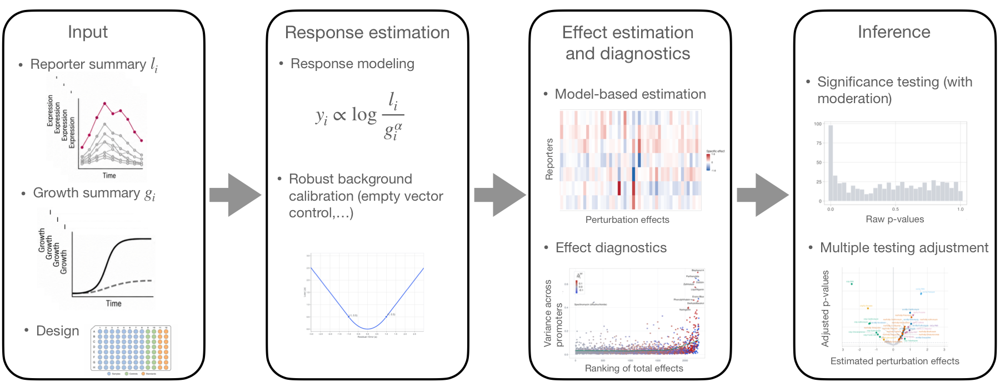

# DStressR: Differential stress-response modeling for chemical genomics screens

This repository hosts the `DStressR` R package and companion analysis workflow
for high-throughput reporter-perturbation screens. `DStressR` models reporter
responses after accounting for growth, perturbation-wide effects, technical
covariates, and reporter-specific uncertainty.



> [!TIP]
> Growth summaries can come from simple AUC or endpoint summaries, from the
> original screen export, or from upstream growth-curve modeling workflows.
> DGrowthR-derived growth parameters can be handed over explicitly when desired.

## Installation Guide

To install the `DStressR` R package directly from this repository, first clone
the repository and enter the cloned folder. Then execute the following commands
in R.

1. Ensure that you have the `devtools` package installed. If not, you can
   install it using the following command:

```r
# Install devtools
install.packages("devtools")

# Load the library
library(devtools)
```

2. Use the `install` function to install the `DStressR` package:

```r
install()
```

## Get started

DStressR uses a three-step model-based workflow. `fit_destress()` creates a
reusable fitted object, `results()` constructs the contrast-level inferential
table under the selected uncertainty model, and `call_hits()` applies chosen
effect-size and false-discovery-rate thresholds. The major choices are
explicit: normalization, test statistic and p-value calculation, replicate
aggregation, and p-value adjustment. Named presets reproduce published
screen-specific workflows:

- `preset = "model"` for the model-based DStressR analysis
- `preset = "median_polish"` for the Campylobacter median-polish workflow from
  Zannoni et al. (2026, bioRxiv, doi:10.64898/2026.10.05.755907)
- `preset = "empty_vector_control"` for the Salmonella empty-vector-control
  workflow from Amstalden et al. (2026, bioRxiv,
  doi:10.64898/2026.09.30.755304)

The GitHub Pages site organizes the reproducible examples as DStressR articles:

- [Get started with DStressR](https://muellsen.github.io/DStressR/articles/DStressR.html)
- [E. coli promoter-compound screen](https://muellsen.github.io/DStressR/articles/ecoli-promoter-screen.html)
- [PFIbox promoter-activity screen](https://muellsen.github.io/DStressR/articles/pfibox-promoter-activity-screen.html)
- [E. coli fluorescence stress screen](https://muellsen.github.io/DStressR/articles/ecoli-fluorescence-stress-screen.html)
- [Kochanowski summary response matrix](https://muellsen.github.io/DStressR/articles/kochanowski-summary-response-matrix.html)
- [Campylobacter median-polish workflow](https://muellsen.github.io/DStressR/articles/median-polish-workflow.html)
- [Salmonella empty-vector-control workflow](https://muellsen.github.io/DStressR/articles/salmonella-empty-vector-workflow.html)

The model workflow starts from an assay prepared with `prepare_assay()`:

```r
library(DStressR)

screen <- simulate_screen(seed = 1)

assay <- prepare_assay(
  screen,
  reporter = "reporter",
  perturbation = "perturbation",
  control = "DMSO",
  lux = "LUX.AUC_16",
  growth = "od_16h.measured",
  batch = "batch",
  replicate = "replicate"
)

fit <- fit_destress(
  assay,
  preset = "model",
  technical = c("batch", "replicate"),
  testing = "moderated_t"
)

tab <- results(fit)
hits <- call_hits(tab, fdr = 0.05, effect = "total_effect")
```

The fitted object retains the response construction, fitted effect model, and
selected inferential configuration. This makes it possible to inspect model
parameters or extract different effect tables without refitting the assay.

## Public E. coli Promoter-Compound Screen

`DStressR` ships the public *E. coli* reporter-screen AUC data from
Binsfeld et al. (2025), PLOS Biology, as `binsfeld_reporter_auc`. The matching
author score/Z-score table is available as `binsfeld_reporter_scores`.

```r
data("binsfeld_reporter_auc")

wt_auc <- subset(
  binsfeld_reporter_auc,
  strain == "WT" & removed == "No"
)

assay <- prepare_assay(
  wt_auc,
  reporter = "reporter",
  perturbation = "drug",
  control = c("Water_1", "Water_2"),
  lux = "lux_auc",
  growth = "od_auc",
  growth_exponent = "estimate",
  batch = "dose_level",
  replicate = "replicate",
  growth_covariates = "replicate",
  numeric_covariates = "dose_level",
  background_reporter = "EVC",
  background_by = c("drug", "dose_level", "replicate")
)

fit <- fit_destress(
  assay,
  preset = "model",
  technical = c("replicate", "dose_level"),
  testing = "moderated_t",
  adjustment = "by_reporter",
  interaction = FALSE
)
```

Here `growth_covariates = "replicate"` keeps the water-control growth-response
model separate from the downstream concentration-index adjustment: `dose_level`
is used in the perturbation-effect model, not in the estimation of `alpha_g`.

The public sources are the PLOS article
<https://doi.org/10.1371/journal.pbio.3003260> and the Zenodo archive
<https://doi.org/10.5281/zenodo.15600688>. The primary reproducibility script
`analysis/ecoli_promoter_screen/run_evc_calibrated_analysis.R` rebuilds the
Binsfeld-style Wilcoxon/Z-score hit calls and compares them with the two default
DStressR workflows. In the current WT analysis, the reconstructed reference rule
calls 53 hits, DStressR without EVC calls 80 hits, and DStressR with EVC
calls 92 hits. The workflow with EVC overlaps with 37 of the 53
reference hits. The optional full interaction-model analysis is
reproduced by `analysis/ecoli_promoter_screen/run_interaction_model.R`.

Equivalently, using staged options directly:

```r
fit <- fit_destress(
  screen,
  normalization = "model",
  testing = "moderated_t",
  aggregation = "none",
  adjustment = "global",
  reporter = "reporter",
  perturbation = "perturbation",
  control = "DMSO",
  lux = "LUX.AUC_16",
  growth = "od_16h.measured",
  growth_exponent = "estimate",
  batch = "batch",
  replicate = "replicate",
  technical = c("batch", "replicate")
)
```

Growth-response normalization for the model path is controlled in
`prepare_assay()` or by passing the same arguments through `fit_destress()`.
Use `growth_exponent = 1` for the fixed log2(LUX / OD) normalization,
`growth_exponent = "estimate"` to estimate reporter-specific `alpha_g` values
from controls, or pass a named reporter vector.

In model-based analyses, `testing = "moderated_t"` is the default moderated
model and `testing = "student_t"` is the ordinary Student-$t$ comparison model.
The local Campylobacter comparison uses the default moderated model against the
median-polish max-p workflow.

## Summary-level analyses with supplied variances

Some public reporter resources release processed response estimates together
with uncertainty estimates, but not the replicate-level wells. These datasets
can be analyzed with `fit_destress_summary()`. The input is one row per
reporter and perturbation, with a response estimate and its sampling variance.

```r
summary_fit <- fit_destress_summary(
  processed_response_table,
  reporter = "reporter",
  perturbation = "condition",
  response = "log2_promoter_activity",
  response_variance = "log2_promoter_activity_variance",
  reference_perturbation = "glucose",
  global_method = "weighted_mean",
  background_rank = 1
)

summary_results <- results(summary_fit)
```

This path estimates reference-relative total effects, inverse-variance weighted
perturbation-wide effects, reporter-specific effects, optional low-rank
background adjustments, and summary-level Gaussian p-values. It is intended for
processed datasets with reported variances and should not be confused with the
replicate-level moderated model fitted by `fit_destress()`.

## Model-based Background Reporter Calibration

If the screen contains an Empty Vector Control (EVC) reporter, it can be used
when constructing the model-based response. This is different from the
project-level `preset = "empty_vector_control"` workflow below: the model-based
path still fits reporter-specific linear models, but first calibrates each
non-background reporter against the matched background reporter.

```r
assay <- prepare_assay(
  expression_df,
  reporter = "promoter",
  perturbation = "srn_code",
  control = "DMSO",
  lux = "LUX.AUC_16",
  growth = "od_16h.measured",
  batch = "batch",
  replicate = "replicate",
  background_reporter = "PEVC3",
  background_by = c("srn_code", "batch", "replicate")
)

fit <- fit_destress(assay, technical = c("batch", "replicate"))
tab <- results(fit)
```

When `background_reporter` is supplied, `prepare_assay()` uses Huber
calibration by default. Use `background_method = "lm"` for least-squares
calibration or `background_method = "subtract"` for direct matched-background
subtraction. Without `background_reporter`, no background calibration is
applied and the default DStressR workflow is unchanged.

The fitted object stores growth-exponent and background-calibration metadata,
and the background reporter is excluded from model-based testing.

Alternatively, retain the background reporter and subtract its fitted
treatment-reference effect from each reporter's fitted total effect:

```r
assay <- prepare_assay(
  expression_df,
  reporter = "promoter", perturbation = "srn_code", control = "DMSO",
  lux = "LUX.AUC_16", growth = "od_16h.measured",
  batch = "batch", replicate = "replicate"
)
fit <- fit_destress(assay, technical = c("batch", "replicate"),
                    empty_vector_reporter = "PEVC3")
tab <- results(fit)
```

With the default `background_rank = 0`, `rank_adjusted_total_effect` and its
matching standard errors and p-values describe the EVC-adjusted total effect;
`total_effect` and `total_*` inference columns retain the unadjusted total
effect. The EVC-adjusted variance combines raw reporter and EVC contrast
variances with Welch-Satterthwaite degrees of freedom, followed by one
moderation step. Response-level background correction and fitted-effect EVC
subtraction are alternative routes; combining them raises an error before
model fitting. Fitted-effect EVC subtraction requires `interaction = FALSE`.

Estimated model components, including growth-exponent parameters and
reporter-perturbation effect estimates, can be extracted with:

```r
params <- model_parameters(fit)

growth_parameters <- params$growth_exponents
reporter_effects <- params$reporter_effects
```

The Campylobacter median-polish workflow starts from the exported expression
table and DMSO library-well IDs used by Zannoni et al. (2026, bioRxiv,
doi:10.64898/2026.10.05.755907):

```r
campy_fit <- fit_destress(
  expression_df,
  preset = "median_polish",
  response = "log2.auc.16hmeasured.normed",
  control = dmso_srn_codes,
  exclude = dmso_noisy_srn_codes,
  normality = TRUE
)

dmso_normality <- campy_fit$normality_results
replicate_pvalues <- campy_fit$replicate_results
hit_table <- campy_fit$pair_results
```

The Salmonella empty-vector-control workflow from Amstalden et al. (2026,
bioRxiv, doi:10.64898/2026.09.30.755304) uses the same named interface:

```r
evc <- fit_destress(
  expression_df,
  preset = "empty_vector_control",
  response = "log2.lux.normed.centered",
  empty_vector_reporter = "PEVC3",
  control = dmso_srn_codes,
  exclude = dmso_noisy_srn_codes
)

hit_table <- evc$pair_results
```

## How to use `DStressR`

The typical DStressR analysis starts from reporter-level luminescence and growth
summaries, together with perturbation, reporter, replicate, plate, and batch
metadata.

```r
library(DStressR)

assay <- prepare_assay(
  expression_df,
  reporter = "promoter",
  perturbation = "srn_code",
  control = "DMSO",
  lux = "LUX.AUC_16",
  growth = "od_16h.measured",
  batch = "batch",
  replicate = "replicate"
)

fit <- fit_destress(
  assay,
  normalization = "model",
  testing = "moderated_t",
  aggregation = "none",
  adjustment = "global",
  technical = c("batch", "replicate")
)

tab <- results(fit)
hits <- call_hits(tab, fdr = 0.05, effect = "total_effect")
```

The fitted model separates two related quantities:

- `total_effect`: control-relative reporter response for a perturbation.
- `specific_effect`: reporter-specific response after subtracting the
  perturbation-wide effect shared across reporters.

This distinction is important for perturbations that globally affect growth,
luminescence, metabolism, or assay chemistry.

Total effects are the default target for hit calling and effect plots. Use
`total_effect`, `total_pvalue`, `total_padj_global`, and
`total_padj_by_reporter` from `results(fit)`. Centered specific effects remain
available through the corresponding `specific_*` columns; select these
explicitly when the question concerns departures from the reporter-panel average.

The compatibility wrapper `fit_workflow()` and the lower-level functions
`fit_median_polish()` and `fit_empty_vector_control()` remain available for
existing scripts. New analyses should prefer `fit_destress()` so that the
selected statistical path is explicit in the code.

## Diagnostic and Summary Plots

`DStressR` includes output plots for common screening summaries,
including volcano plots, reporter-perturbation response heatmaps, clustered
heatmaps, effect histograms, and empirical-Bayes variance diagnostics.

```r
plot_volcano(
  tab,
  effect = "total_effect",
  padj = "total_padj",
  top_n = 12,
  top_reporters = 6
)

plot_response_heatmap(
  tab,
  value = "total_effect"
)
```

## Required input shape

DStressR expects a long reporter-perturbation table with one row per measured
reporter-perturbation-replicate observation. In a complete rectangular screen, the
number of rows is approximately:

```text
n_reporters x (n_perturbation_wells + n_control_wells) x n_replicates
```

Additional rows can occur when the same design is repeated across batches,
library plates, measurement plates, or experimental days.

At minimum, the expression table must contain columns that identify:

- promoter or reporter construct, for example `promoter`
- compound or library well, for example `compound`, `srn_code`, or
  `libplate` plus `well`
- negative-control compound, usually `DMSO`
- luminescence summary, for example `LUX.AUC_16`
- growth summary, for example `od_16h.measured`
- replicate and technical covariates, for example `replicate`, `batch`,
  `plate`, or `libplate`

These columns are mapped explicitly in `prepare_assay()`, so projects can use
their own column names:

```r
assay <- prepare_assay(
  expression_df,
  reporter = "promoter",
  perturbation = "srn_code",
  control = "DMSO",
  lux = "LUX.AUC_16",
  growth = "od_16h.measured",
  batch = "batch",
  plate = "libplate",
  replicate = "replicate"
)
```

## Campylobacter workflow input files

For the original Campylobacter promoter-library workflow, DStressR includes the
helper `read_campylobacter_expression()`. It joins two exported files:

1. `expression_values.tsv.gz`

   A long measurement table with one row per promoter-library-well-replicate
   observation. It should contain either:

   - `srn_code`, a unique library-well identifier, or
   - both `libplate` and `well`, from which `srn_code` is reconstructed as
     `paste(libplate, well, sep = "_")`.

   It should also contain the promoter identifier, luminescence summary, growth
   summary, and technical covariates used downstream in `prepare_assay()`.

2. `LibMap.txt`

   A library annotation table with one row per compound/library well. Required
   columns are:

   - `Library plate`
   - `Well`
   - `ProductName`
   - `Catalog Number`

   The helper converts these to a compound key
   `srn_code = paste0("lp", Library plate, "_", Well)` and joins
   `ProductName` and `Catalog Number` onto the expression table.

```r
expression_df <- read_campylobacter_expression(
  expression_file = "expression_values.tsv.gz",
  libmap_file = "LibMap.txt"
)
```

The returned object has the same number of rows as `expression_values.tsv.gz`,
with compound annotations added. This joined table can then be passed directly
to `prepare_assay()`.

The public template script
`scripts/export_campy_default_model_template.R` records the exact
Campylobacter default-model call used to regenerate the local package output
`analysis/outputs/package_results/destress_moderated_pair_results.tsv` from the
proprietary expression table. It sets `testing = "moderated_t"`,
`interaction = FALSE`, `background_rank = 0`, uses reporter-specific estimated
growth exponents, and exports the `specific_*` result columns expected by the
downstream analysis scripts. The `scripts/README.md` file highlights this
data-free export template as the canonical place to inspect the actual
local model call.

To reproduce the Campylobacter median-polish workflow from Zannoni et al.
(2026, bioRxiv, doi:10.64898/2026.10.05.755907), provide the DMSO
library-well IDs and optional noisy-DMSO well IDs from `LibMap.txt`:

```r
libmap <- read.delim("LibMap.txt", check.names = FALSE)
libmap$srn_code <- paste0("lp", libmap[["Library plate"]], "_", libmap[["Well"]])

dmso_srn_codes <- libmap$srn_code[libmap$ProductName == "DMSO"]
dmso_noisy_srn_codes <- libmap$srn_code[libmap$ProductName == "DMSO noisy"]

campy_fit <- fit_destress(
  expression_df,
  preset = "median_polish",
  response = "log2.auc.16hmeasured.normed",
  control = dmso_srn_codes,
  exclude = dmso_noisy_srn_codes,
  normality = TRUE
)

dmso_normality <- campy_fit$normality_results
replicate_pvalues <- campy_fit$replicate_results
hit_table <- campy_fit$pair_results
```

## Salmonella empty-vector-control workflow

The Salmonella workflow from Amstalden et al. (2026, bioRxiv,
doi:10.64898/2026.09.30.755304) uses a stronger control design than DMSO-only
normalization. In addition to DMSO wells, it includes Empty Vector Control
reporters, especially `PEVC3`, which measure compound-specific background Lux
signal without a promoter insert. DStressR exposes this baseline through
`fit_empty_vector_control()`.

The required processed expression table is the output of the Salmonella
Lux-estimation step, usually `lux_auc_filtered_median.tsv.gz`. It is a long
table with one row per promoter-library-well-replicate observation and contains:

- `promoter`
- `srn_code`
- `replicate`
- `log2.lux.normed.centered`

The library map is `LibMap.tsv.gz`, with columns:

- `Library plate`
- `New well`
- `Catalog Number`
- `ProductName`

```r
expression_df <- read.delim(gzfile("lux_auc_filtered_median.tsv.gz"),
                            check.names = FALSE)
libmap <- read.delim(gzfile("LibMap.tsv.gz"), check.names = FALSE)

libmap$libplate <- sub("LibPlate", "lp", libmap[["Library plate"]])
libmap$srn_code <- paste(libmap$libplate, libmap[["New well"]], sep = "_")

dmso_srn_codes <- libmap$srn_code[libmap[["Catalog Number"]] == "DMSO"]
dmso_noisy_srn_codes <- libmap$srn_code[libmap[["Catalog Number"]] == "DMSO noisy"]

evc <- fit_destress(
  expression_df,
  preset = "empty_vector_control",
  response = "log2.lux.normed.centered",
  empty_vector_reporter = "PEVC3",
  control = dmso_srn_codes,
  exclude = dmso_noisy_srn_codes,
  remove_reporters = "PmgrR"
)

replicate_pvalues <- evc$replicate_results
hit_table <- evc$pair_results
```

On the local Salmonella workflow output, this DStressR implementation recovers
the original `hit_table.tsv.gz` numerically, including the final hit labels.

## Optional DGrowthR handoff

If growth curves have already been modeled with DGrowthR, DStressR can use a
chosen DGrowthR growth parameter as the growth column for a sensitivity
analysis:

```r
expression_df2 <- add_dgrowthr_growth(
  expression_df,
  object = dgrowthr_fit,
  by = "curve_id",
  model_covariate = "curve_id",
  growth_metric = "OD_16",
  output = "dgrowthr_od16"
)

assay <- prepare_assay(
  expression_df2,
  reporter = "promoter",
  perturbation = "srn_code",
  control = "DMSO",
  lux = "LUX.AUC_16",
  growth = "dgrowthr_od16"
)
```

## Analysis workflow

The repository separates the R package from downstream reproducibility work.
The package API, data objects, documentation, and tests live in `R/`, `data/`,
`man/`, `vignettes/`, and `tests/`. The `analysis/` folder is a downstream
comparison and figure-generation layer that is excluded from the CRAN source
package.

Canonical DStressR manuscript analyses live in
`analysis/ecoli_promoter_screen/` and `analysis/dryad_global_regulators/`.
Earlier Campylobacter work is retained in `analysis/campylobacter_manuscript/`
for future analysis manuscripts, and exploratory datasets belong under
`analysis/exploratory/`.

Analysis scripts read package-generated outputs and must not reimplement
estimators, p-value calculations, empirical-Bayes moderation, replicate
aggregation, or multiple-testing correction. Generated outputs under
`analysis/outputs/` are intentionally ignored by Git so regenerated result
tables and manuscript figures stay local.

The package manuscript source lives under
`paper/dstressr_package_manuscript/`. It is not part of the CRAN package, but
its source and reproducibility instructions are intended to be versioned with
the repository.
