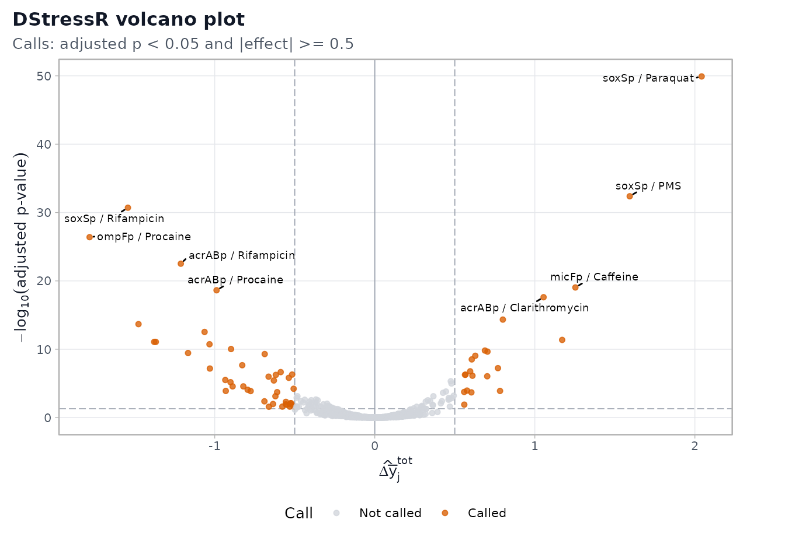
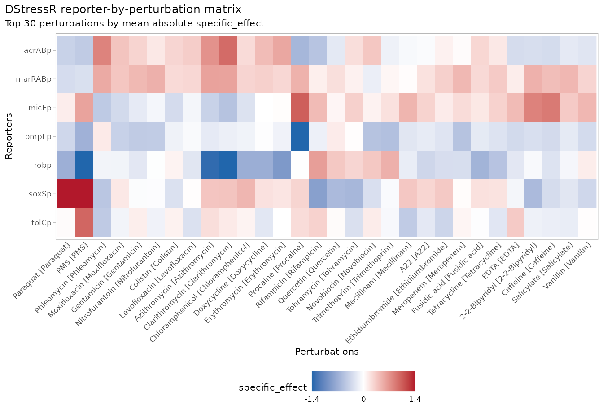
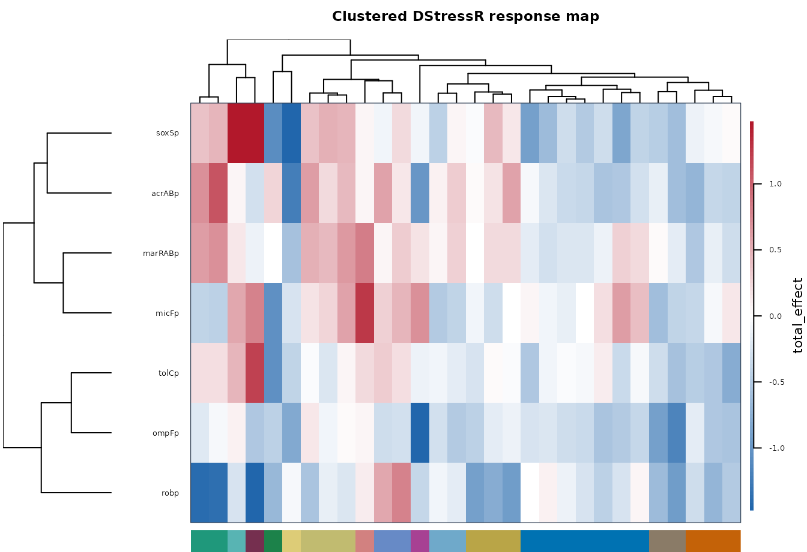

# Get started with DStressR

`DStressR` models reporter-activity responses in high-throughput
reporter and chemical-genomics screens. It constructs growth-adjusted
responses, estimates reporter-perturbation effects, moderates
uncertainty, and returns reproducible hit tables with diagnostic plots.
Growth summaries can come from any upstream workflow, including simple
AUC or endpoint summaries and, when available, growth-curve models.

The package site contains use-case articles for the main analysis
settings:

- *E. coli* promoter-compound screen with empty-vector calibration
- PFIbox fluorescence promoter-activity screen
- *E. coli* fluorescence stress screen
- Kochanowski promoter-activity compendium with supplied variances
- Salmonella empty-vector-control screen-specific workflow

This vignette uses the public *E. coli* reporter-compound screen of
Binsfeld et al. (2025), distributed with DStressR as a compact AUC-level
data object. The data originate from the PLOS Biology supplementary data
and associated Zenodo archive
(<https://doi.org/10.1371/journal.pbio.3003260>;
<https://doi.org/10.5281/zenodo.15600688>).

## Input files and table shape

DStressR expects a long measurement table with one row per measured
reporter-perturbation-replicate observation. In a complete rectangular
screen, the row count is approximately:

``` text
n_reporters x (n_compound_wells + n_control_wells) x n_replicates
```

The table may contain additional rows when the same screen is repeated
across batches, library plates, measurement plates, or experimental
days. The important point is that these technical covariates remain in
the table so they can be modeled rather than accidentally averaged away.

The required biological and technical information is:

- reporter or reporter construct
- perturbation or library-well identifier
- reference perturbation, for example `DMSO` or water controls
- luminescence summary
- growth summary
- replicate and optional technical covariates such as batch or plate

Column names are not fixed. They are mapped explicitly in
[`prepare_assay()`](https://muellsen.github.io/DStressR/reference/prepare_assay.md).

## Load the public *E. coli* reporter-compound screen

``` r

library(DStressR)

screen <- subset(
  binsfeld_reporter_auc,
  strain == "WT" & removed == "No"
)

head(screen)
#>   strain reporter replicate well              drug          compound
#> 1     WT      EVC         1   A1           Water_1             Water
#> 2     WT      EVC         1   A2           Water_1             Water
#> 3     WT      EVC         1   A3 1-Methyluric acid 1-Methyluric acid
#> 4     WT      EVC         1   A4 1-Methyluric acid 1-Methyluric acid
#> 5     WT      EVC         1   A5          2,3-DHBA          2,3-DHBA
#> 6     WT      EVC         1   A6          2,3-DHBA          2,3-DHBA
#>   concentration_index dose_level concentration_ug_ml   od_auc   lux_auc
#> 1                   1          4                 0.0 2.435875 1209.7240
#> 2                   2          3                 0.0 2.657758  963.9789
#> 3                   1          4                91.1 2.431864 1098.3103
#> 4                   2          3                45.5 2.354903 1212.2085
#> 5                   1          4               154.1 2.057219  958.0157
#> 6                   2          3                77.1 2.180038  996.1697
#>   od_auc_per_lux_auc removed
#> 1           496.6282      No
#> 2           362.7038      No
#> 3           451.6331      No
#> 4           514.7595      No
#> 5           465.6849      No
#> 6           456.9506      No
```

The table contains one row per reporter, drug or water-reference well,
replicate, and serial-dilution observation. The original `drug` labels
are retained, including `Water_1` and `Water_2`; `dose_level` increases
with compound concentration.

``` r

names(screen)
#>  [1] "strain"              "reporter"            "replicate"          
#>  [4] "well"                "drug"                "compound"           
#>  [7] "concentration_index" "dose_level"          "concentration_ug_ml"
#> [10] "od_auc"              "lux_auc"             "od_auc_per_lux_auc" 
#> [13] "removed"
```

## Prepare the assay

[`prepare_assay()`](https://muellsen.github.io/DStressR/reference/prepare_assay.md)
converts luminescence and growth summaries into a growth-adjusted log2
response. By default, DStressR estimates reporter-specific growth
exponents from reference-condition wells and shrinks them toward a
global reference-well slope.

``` r

assay <- prepare_assay(
  screen,
  reporter = "reporter",
  perturbation = "drug",
  control = c("Water_1", "Water_2"),
  lux = "lux_auc",
  growth = "od_auc",
  growth_exponent = "estimate",
  batch = "dose_level",
  replicate = "replicate",
  growth_covariates = "replicate",
  numeric_covariates = "dose_level",
  background_reporter = "EVC",
  background_by = c("drug", "dose_level", "replicate")
)

attr(assay, "destress")$growth_exponent_fit
#>   reporter control_n log_growth_sd     a_raw  a_raw_se a_raw_df  alpha_raw
#> 1   acrABp        16     0.2037412 12.082727 0.5257436       13 0.06996704
#> 2      EVC        16     0.1933252  9.823428 0.5023973       13 0.28970550
#> 3  marRABp        16     0.1715475 13.146961 0.2564950       13 0.53073940
#> 4    micFp        16     0.1799482 12.874535 0.2465778       13 0.74801983
#> 5    ompFp        16     0.1365465 15.489428 0.4125433       13 0.81220933
#> 6     robp        16     0.1088960 11.196892 0.8472631       13 0.50412672
#> 7    soxSp        16     0.1880037 13.499497 0.2459610       13 0.37824790
#> 8    tolCp        16     0.2010756  9.813360 0.6271326       13 0.12269575
#>   alpha_raw_se alpha_raw_df alpha_covariates alpha_global alpha_global_se
#> 1    0.3097976           13        replicate     0.379046      0.09937215
#> 2    0.3391082           13        replicate     0.379046      0.09937215
#> 3    0.1529305           13        replicate     0.379046      0.09937215
#> 4    0.1518801           13        replicate     0.379046      0.09937215
#> 5    0.2545487           13        replicate     0.379046      0.09937215
#> 6    0.5261529           13        replicate     0.379046      0.09937215
#> 7    0.1622378           13        replicate     0.379046      0.09937215
#> 8    0.4110460           13        replicate     0.379046      0.09937215
#>   alpha_global_covariates alpha_prior_var alpha_prior_sd alpha_shrunk
#> 1      reporter;replicate           1e-04           0.01    0.3787242
#> 2      reporter;replicate           1e-04           0.01    0.3789683
#> 3      reporter;replicate           1e-04           0.01    0.3796918
#> 4      reporter;replicate           1e-04           0.01    0.3806386
#> 5      reporter;replicate           1e-04           0.01    0.3797134
#> 6      reporter;replicate           1e-04           0.01    0.3790911
#> 7      reporter;replicate           1e-04           0.01    0.3790429
#> 8      reporter;replicate           1e-04           0.01    0.3788943
#>   alpha_shrunk_se alpha_fixed_one alpha_diff_from_one
#> 1     0.009994794               1          -0.6212758
#> 2     0.009995655               1          -0.6210317
#> 3     0.009978690               1          -0.6203082
#> 4     0.009978395               1          -0.6193614
#> 5     0.009992292               1          -0.6202866
#> 6     0.009998194               1          -0.6209089
#> 7     0.009981058               1          -0.6209571
#> 8     0.009997042               1          -0.6211057
```

To reproduce a fixed-ratio response, set `growth_exponent = 1`, which
gives the `log2(luminescence / growth)` scale after the same optional
EVC calibration.

## Fit the model workflow

[`fit_destress()`](https://muellsen.github.io/DStressR/reference/fit_destress.md)
creates the fitted model object while accounting for technical
covariates and retains the selected inferential configuration.
[`results()`](https://muellsen.github.io/DStressR/reference/results.md)
then constructs the contrast-level inferential table, and
[`call_hits()`](https://muellsen.github.io/DStressR/reference/call_hits.md)
adds directional calls at a chosen false-discovery-rate threshold. The
result table reports both the reference-relative total effect and the
reporter-specific effect after subtracting the perturbation-wide effect.

``` r

fit <- fit_destress(
  assay,
  technical = c("replicate", "dose_level"),
  testing = "moderated_t",
  adjustment = "by_reporter"
)

tab <- results(fit)

head(tab)
#>    reporter          perturbation total_effect  total_se total_statistic
#> 1    acrABp     1-Methyluric acid -0.021457035 0.1014051     -0.21159725
#> 13   acrABp         2-2-Bipyridyl -0.507066908 0.1119016     -4.53136423
#> 21   acrABp              2,3-DHBA -0.127903232 0.1014051     -1.26130999
#> 28   acrABp   4-Aminobenzoic acid  0.078135567 0.1014051      0.77052917
#> 35   acrABp 4-Aminosalicylic acid -0.008980912 0.1014051     -0.08856472
#> 42   acrABp                   A22 -0.369214389 0.1119016     -3.29945585
#>    total_pvalue additive_total_effect additive_total_se empty_vector_effect
#> 1  8.324886e-01                    NA                NA                  NA
#> 13 6.992870e-06                    NA                NA                  NA
#> 21 2.076565e-01                    NA                NA                  NA
#> 28 4.412702e-01                    NA                NA                  NA
#> 35 9.294555e-01                    NA                NA                  NA
#> 42 1.022436e-03                    NA                NA                  NA
#>    background_adjusted_effect global_effect  global_se global_statistic
#> 1                -0.021457035    0.01047815 0.05076760        0.2063945
#> 13               -0.507066908   -0.22174188 0.05608266       -3.9538400
#> 21               -0.127903232   -0.01358238 0.05076760       -0.2675403
#> 28                0.078135567    0.09810077 0.05076760        1.9323501
#> 35               -0.008980912    0.03766254 0.05076760        0.7418619
#> 42               -0.369214389   -0.33576292 0.05608266       -5.9869289
#>    global_pvalue low_rank_effect rank_adjusted_total_effect
#> 1   8.365492e-01               0               -0.021457035
#> 13  8.559785e-05               0               -0.507066908
#> 21  7.891405e-01               0               -0.127903232
#> 28  5.376286e-02               0                0.078135567
#> 35  4.584466e-01               0               -0.008980912
#> 42  3.586191e-09               0               -0.369214389
#>    rank_adjusted_total_se rank_adjusted_total_statistic
#> 1               0.1014051                   -0.21159725
#> 13              0.1119016                   -4.53136423
#> 21              0.1014051                   -1.26130999
#> 28              0.1014051                    0.77052917
#> 35              0.1014051                   -0.08856472
#> 42              0.1119016                   -3.29945585
#>    rank_adjusted_total_pvalue rank_adjusted_global_effect specific_effect
#> 1                8.324886e-01                  0.01047815     -0.03193519
#> 13               6.992870e-06                 -0.22174188     -0.28532503
#> 21               2.076565e-01                 -0.01358238     -0.11432085
#> 28               4.412702e-01                  0.09810077     -0.01996520
#> 35               9.294555e-01                  0.03766254     -0.04664346
#> 42               1.022436e-03                 -0.33576292     -0.03345147
#>    specific_se specific_statistic specific_pvalue total_var_raw specific_var
#> 1   0.09962289         -0.3205608     0.748604851    0.01018467   0.00985797
#> 13  0.10998930         -2.5941162     0.009610906    0.01246399   0.01206410
#> 21  0.09962289         -1.1475360     0.251412462    0.01018467   0.00985797
#> 28  0.09962289         -0.2004078     0.841199151    0.01018467   0.00985797
#> 35  0.09962289         -0.4682002     0.639735227    0.01018467   0.00985797
#> 42  0.10998930         -0.3041338     0.761084090    0.01246399   0.01206410
#>    residual_df specific_df_raw specific_df_for_test total_padj_global
#> 1          629        1071.458             1087.833      0.9619023849
#> 13         629        1071.445             1087.820      0.0001022513
#> 21         629        1071.458             1087.833      0.5296045464
#> 28         629        1071.458             1087.833      0.7887503168
#> 35         629        1071.458             1087.833      0.9940442759
#> 42         629        1071.445             1087.820      0.0084095340
#>    total_padj_by_reporter rank_adjusted_total_padj_global
#> 1            9.315944e-01                    0.9619023849
#> 13           5.975725e-05                    0.0001022513
#> 21           4.174033e-01                    0.5296045464
#> 28           6.690226e-01                    0.7887503168
#> 35           9.600969e-01                    0.9940442759
#> 42           5.653468e-03                    0.0084095340
#>    rank_adjusted_total_padj_by_reporter specific_padj_global
#> 1                          9.315944e-01           0.95570500
#> 13                         5.975725e-05           0.06587475
#> 21                         4.174033e-01           0.65308739
#> 28                         6.690226e-01           0.97322913
#> 35                         9.600969e-01           0.91113805
#> 42                         5.653468e-03           0.95571246
#>    specific_padj_by_reporter   total_padj specific_padj
#> 1                 0.98500411 9.315944e-01    0.98500411
#> 13                0.04522295 5.975725e-05    0.04522295
#> 21                0.56603513 4.174033e-01    0.56603513
#> 28                0.98500411 6.690226e-01    0.98500411
#> 35                0.96393999 9.600969e-01    0.96393999
#> 42                0.98500411 5.653468e-03    0.98500411
```

The key columns are:

- `total_effect`: reference-relative response for the
  reporter-perturbation pair.
- `global_effect`: average perturbation-wide response across reporters.
- `specific_effect`: reporter-specific deviation from the
  perturbation-wide effect.
- `specific_pvalue` and `specific_padj`: test and BH-adjusted p-value.

The direct fitting functions remain available for existing scripts, but
[`fit_destress()`](https://muellsen.github.io/DStressR/reference/fit_destress.md)
is the recommended entry point for new model-based analyses.

## Empty-vector calibration

The Binsfeld screen contains an Empty Vector Control (EVC), which is
used above as a matched background reporter during response
construction. DStressR uses Huber calibration by default; least-squares
calibration and direct subtraction remain available through
`background_method`. The following call prepares the same assay without
EVC calibration for a direct comparison.

``` r

assay_without_evc <- prepare_assay(
  screen,
  reporter = "reporter",
  perturbation = "drug",
  control = c("Water_1", "Water_2"),
  lux = "lux_auc",
  growth = "od_auc",
  growth_exponent = "estimate",
  batch = "dose_level",
  replicate = "replicate",
  growth_covariates = "replicate",
  numeric_covariates = "dose_level"
)
```

## Call hits

``` r

hits <- call_hits(
  tab,
  fdr = 0.05,
  lfc = 0.5,
  effect = "specific_effect",
  padj = "specific_padj"
)

table(hits$hit)
#> 
#> Downregulated        Not DE   Upregulated 
#>            21           618            19

head(
  hits[order(hits$specific_padj, -abs(hits$specific_effect)), ],
  10
)
#>     reporter   perturbation total_effect  total_se total_statistic total_pvalue
#> 458    soxSp       Paraquat    2.0421536 0.1220216       16.736007 1.299286e-52
#> 496    soxSp            PMS    1.5927747 0.1220216       13.053224 8.823718e-35
#> 497     robp            PMS   -1.4764288 0.1750960       -8.432110 2.231139e-16
#> 507    ompFp       Procaine   -1.7820135 0.1513196      -11.776485 4.232902e-29
#> 208   acrABp Clarithromycin    1.0545853 0.1119016        9.424220 7.767458e-20
#> 506    micFp       Procaine    0.7024904 0.1261821        5.567276 3.782979e-08
#> 210     robp Clarithromycin   -1.3681767 0.1832087       -7.467859 2.663925e-13
#> 76      robp   Azithromycin   -1.3785716 0.1832087       -7.524597 1.789489e-13
#> 121    micFp       Caffeine    1.2532229 0.1261821        9.931861 9.637828e-22
#> 553    soxSp     Rifampicin   -1.5424675 0.1220216      -12.640943 6.223887e-33
#>     additive_total_effect additive_total_se empty_vector_effect
#> 458                    NA                NA                  NA
#> 496                    NA                NA                  NA
#> 497                    NA                NA                  NA
#> 507                    NA                NA                  NA
#> 208                    NA                NA                  NA
#> 506                    NA                NA                  NA
#> 210                    NA                NA                  NA
#> 76                     NA                NA                  NA
#> 121                    NA                NA                  NA
#> 553                    NA                NA                  NA
#>     background_adjusted_effect global_effect  global_se global_statistic
#> 458                  2.0421536    0.44247430 0.05076760         8.715684
#> 496                  1.5927747    0.16081460 0.05076760         3.167662
#> 497                 -1.4764288    0.16081460 0.05076760         3.167662
#> 507                 -1.7820135   -0.35237122 0.05076760        -6.940869
#> 208                  1.0545853    0.07883706 0.05335092         1.477708
#> 506                  0.7024904   -0.35237122 0.05076760        -6.940869
#> 210                 -1.3681767    0.07883706 0.05335092         1.477708
#> 76                  -1.3785716   -0.01747403 0.05299562        -0.329726
#> 121                  1.2532229    0.36926273 0.05076760         7.273591
#> 553                 -1.5424675   -0.69445748 0.05388049       -12.888848
#>     global_pvalue low_rank_effect rank_adjusted_total_effect
#> 458  2.534090e-17               0                  2.0421536
#> 496  1.610766e-03               0                  1.5927747
#> 497  1.610766e-03               0                 -1.4764288
#> 507  9.684461e-12               0                 -1.7820135
#> 208  1.399842e-01               0                  1.0545853
#> 506  9.684461e-12               0                  0.7024904
#> 210  1.399842e-01               0                 -1.3681767
#> 76   7.417163e-01               0                 -1.3785716
#> 121  1.039992e-12               0                  1.2532229
#> 553  6.490793e-34               0                 -1.5424675
#>     rank_adjusted_total_se rank_adjusted_total_statistic
#> 458              0.1220216                     16.736007
#> 496              0.1220216                     13.053224
#> 497              0.1750960                     -8.432110
#> 507              0.1513196                    -11.776485
#> 208              0.1119016                      9.424220
#> 506              0.1261821                      5.567276
#> 210              0.1832087                     -7.467859
#> 76               0.1832087                     -7.524597
#> 121              0.1261821                      9.931861
#> 553              0.1220216                    -12.640943
#>     rank_adjusted_total_pvalue rank_adjusted_global_effect specific_effect
#> 458               1.299286e-52                  0.44247430       1.5996793
#> 496               8.823718e-35                  0.16081460       1.4319601
#> 497               2.231139e-16                  0.16081460      -1.6372434
#> 507               4.232902e-29                 -0.35237122      -1.4296422
#> 208               7.767458e-20                  0.07883706       0.9757482
#> 506               3.782979e-08                 -0.35237122       1.0548616
#> 210               2.663925e-13                  0.07883706      -1.4470137
#> 76                1.789489e-13                 -0.01747403      -1.3610976
#> 121               9.637828e-22                  0.36926273       0.8839602
#> 553               6.223887e-33                 -0.69445748      -0.8480100
#>     specific_se specific_statistic specific_pvalue total_var_raw specific_var
#> 458   0.1150062          13.909508    3.641795e-40    0.01487429   0.01320770
#> 496   0.1150062          12.451158    4.517557e-33    0.01487429   0.01320770
#> 497   0.1563644         -10.470690    4.646025e-24    0.03092616   0.02467332
#> 507   0.1376044         -10.389511    8.190720e-24    0.02302744   0.01903138
#> 208   0.1086268           8.982576    1.219199e-18    0.01246399   0.01175983
#> 506   0.1181704           8.926615    2.332857e-18    0.01592514   0.01395831
#> 210   0.1636651          -8.841308    6.490081e-18    0.03388511   0.02706063
#> 76    0.1635479          -8.322319    3.990072e-16    0.03388511   0.02702221
#> 121   0.1181704           7.480386    1.725831e-13    0.01592514   0.01395831
#> 553   0.1164120          -7.284562    6.564589e-13    0.01487429   0.01353933
#>     residual_df specific_df_raw specific_df_for_test total_padj_global
#> 458         644        932.6083             948.9834      8.549304e-50
#> 496         644        932.6083             948.9834      2.903003e-32
#> 497         632        744.2360             760.6110      1.468090e-14
#> 507         625        788.4796             804.8547      6.963123e-27
#> 208         629       1021.8465            1038.2216      6.388734e-18
#> 506         641        905.5763             921.9513      8.297334e-07
#> 210         632        745.6868             762.0618      1.252045e-11
#> 76          632        743.5805             759.9555      9.057567e-12
#> 121         641        905.5763             921.9513      1.056948e-19
#> 553         644        977.1701             993.5451      1.365106e-30
#>     total_padj_by_reporter rank_adjusted_total_padj_global
#> 458           1.221329e-50                    8.549304e-50
#> 496           4.147148e-33                    2.903003e-32
#> 497           2.097271e-14                    1.468090e-14
#> 507           3.978928e-27                    6.963123e-27
#> 208           2.433803e-18                    6.388734e-18
#> 506           8.890001e-07                    8.297334e-07
#> 210           8.346966e-12                    1.252045e-11
#> 76            8.346966e-12                    9.057567e-12
#> 121           9.059558e-20                    1.056948e-19
#> 553           1.950151e-31                    1.365106e-30
#>     rank_adjusted_total_padj_by_reporter specific_padj_global
#> 458                         1.221329e-50         2.396301e-37
#> 496                         4.147148e-33         1.486276e-30
#> 497                         2.097271e-14         1.019028e-21
#> 507                         3.978928e-27         1.347373e-21
#> 208                         2.433803e-18         1.604466e-16
#> 506                         8.890001e-07         2.558366e-16
#> 210                         8.346966e-12         6.100677e-16
#> 76                          8.346966e-12         3.281834e-14
#> 121                         9.059558e-20         1.261774e-11
#> 553                         1.950151e-31         3.926818e-11
#>     specific_padj_by_reporter   total_padj specific_padj           hit
#> 458              3.423287e-38 1.221329e-50  3.423287e-38   Upregulated
#> 496              2.123252e-31 4.147148e-33  2.123252e-31   Upregulated
#> 497              4.367263e-22 2.097271e-14  4.367263e-22 Downregulated
#> 507              7.699277e-22 3.978928e-27  7.699277e-22 Downregulated
#> 208              1.146047e-16 2.433803e-18  1.146047e-16   Upregulated
#> 506              2.192885e-16 8.890001e-07  2.192885e-16   Upregulated
#> 210              3.050338e-16 8.346966e-12  3.050338e-16 Downregulated
#> 76               1.250222e-14 8.346966e-12  1.250222e-14 Downregulated
#> 121              8.111407e-12 9.059558e-20  8.111407e-12   Upregulated
#> 553              2.056905e-11 1.950151e-31  2.056905e-11 Downregulated
```

In real screens, the FDR cutoff should be paired with domain knowledge
and diagnostics. For reference-rich designs, empirical
replicate/permutation p-values can be used as an additional calibration
check.

## Visualize the screen

The standard volcano plot labels the strongest reporter-perturbation
pairs.

``` r

plot_volcano(
  hits,
  effect = "specific_effect",
  padj = "specific_padj",
  fdr = 0.05,
  lfc = 0.5,
  top_n = 8,
  top_reporters = 6
)
```



A response heatmap gives a matrix-level view of the
reporter-perturbation response surface.

``` r

plot_response_heatmap(
  hits,
  value = "specific_effect",
  top_n_perturbations = 30
)
```



For broader screens, clustered heatmaps help reveal perturbation and
reporter groups with similar response profiles.

``` r

plot_response_clustered_heatmap(
  hits,
  value = "specific_effect",
  top_n_perturbations = 30,
  title = "Clustered DStressR response map"
)
```


